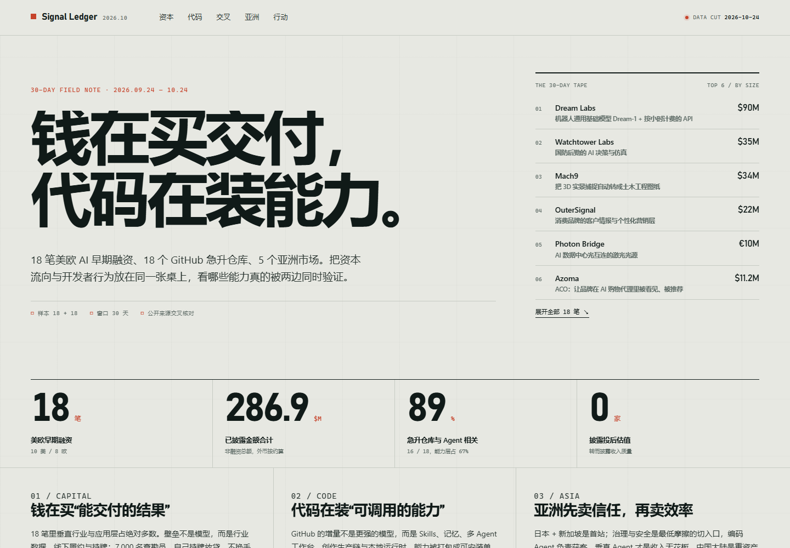

# Signal Ledger 2026.10

30 天美欧 AI 融资、GitHub 急升仓库与亚洲五市场可行性的交互式研究页面。

**在线查看：<https://flypenghyp.github.io/signal-ledger/>**



## 打开

直接双击 `index.html` 即可（无构建、无依赖、无后端）。也可以起一个静态服务：

```powershell
python -m http.server 8771
# http://127.0.0.1:8771
```

## 文件

| 文件 | 作用 |
|---|---|
| `index.html` | 语义化页面结构、章节、控件 |
| `styles.css` | 设计令牌、版式、响应式、动效 |
| `data.js` | 静态数据集（18 笔融资 / 18 个仓库 / 5×5 矩阵） |
| `app.js` | 渲染、筛选、排序、展开、SVG 散点图、滚动高亮 |
| `DESIGN.md` | 设计方向与结构说明 |
| `qa.py` | Playwright 验收脚本（截图、交互、溢出检查） |
| `shots/` | QA 截图（不作为页面资源） |

## 更新数据

只改 `data.js`：

- `deals[]`：`name / hq / region / stage / amount / amountLabel / date / sector / sectorLabel / oneLiner / lead / confidence / notable / asia`
- `repos[]`：`repo / dir / lang / stars / d30 / d7 / quality / what / evidence / url`
- `asia.rows[]`：每行 5 个 `{ level, reason }`，顺序固定为中国大陆、日本、韩国、新加坡+东南亚、印度。

新增或删除条目后，首页统计数字、方向聚类、表格计数会自动重算；`meta.totalDisclosed` 需要手动同步。

## 月度更新

趋势数据按月更新，节奏为每月 24 日：

1. GitHub Action `Monthly trend snapshot`（`.github/workflows/monthly-trends.yml`）在每月 24 日 09:17（Asia/Shanghai）运行 `tools/monthly_trends.py`，抓取 18 个仓库的 star / fork / issue 快照，写入 `trend-snapshots/<YYYY-MM>.json`。
2. 研究团队复核方向聚类与 7 条趋势的亚洲可行性，更新 `data.js` 的 `repos` 与 `trend`（`period`、`updatedAt`、`nextUpdate`、`directions`）。
3. 运行 `python build/publish_signal_ledger.py` 发布，页面上的「月度趋势快照」与「下次更新」自动同步。

## 设计约束

- 冷灰绿纸面 + 深墨 + 朱砂红，无渐变/阴影/圆角卡片堆叠。
- 字体使用系统字体：Bahnschrift（拉丁/数字）、Microsoft YaHei（中文）、Cascadia Mono / Consolas（数据）。
- 散点图为手写 SVG，金额使用 log 轴；REA 作为异常值在表注中说明。
- 所有交互支持键盘；`prefers-reduced-motion` 下关闭动效。

## 验收

`qa.py` 覆盖：桌面 1440 / 平板 768 / 手机 390 无横向溢出、18 条融资、18 个仓库、25 个矩阵格、阶段筛选（种子=10）、地区筛选（欧洲=8）、搜索（YGO=1）、行展开、仓库方向筛选、仓库排序、矩阵点击、移动端菜单与卡片化表格。最近一次运行无 console error / page error。
